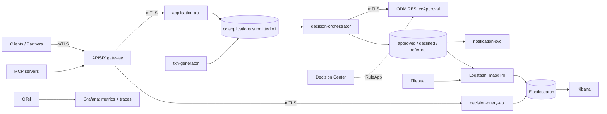

# Maple Northern Bank — Credit Card Decisioning Platform

[](https://github.com/JJ1006/cc-decisioning-platform/actions/workflows/ci.yml)
[](LICENSE)

A portfolio-grade, free-to-run demo of a credit-card approval system for a (fictitious) large Canadian bank.
**IBM ODM** makes the rule decisions, **Kafka** connects every step, decisions land in **Elasticsearch**, and **Kibana** shows business analytics.
An **APISIX** gateway with mTLS fronts the APIs; **Grafana** (metrics, traces) and the **ELK** stack (Logstash, Filebeat, Elasticsearch, Kibana: events, logs, masking) provide observability; **Helm + ArgoCD** deploy to kind or OpenShift; two **MCP servers** let AI agents explain decisions.

> **Principle:** ODM is the deterministic system of record. An LLM never makes or overrides a credit decision.
>
> ⚠ **ODM licence:** IBM ODM for Developers is *not* open source and is for development/evaluation only. It is pulled at runtime and never redistributed. See [NOTICE](NOTICE).
>
> All data is synthetic. "Maple Northern Bank" is fictitious.

## Architecture



Full plan: [docs/PLAN.md](docs/PLAN.md). Decisions: [docs/adr](docs/adr).

## Quickstart

Prerequisites: Docker Desktop (6.5 GB RAM, Rosetta on), JDK 21, Maven, uv, pre-commit, gh.

```bash
cp .env.example .env     # edit placeholders
make help
make pki                 # private CA + certs (not committed)
make up PROFILE=core,analytics
make demo                # send 1000 synthetic applications
make up PROFILE=core,analytics,edge   # + the two HTTP APIs, see docs/api/README.md
make test-api-docs       # runs every curl example of docs/api/README.md
```

(Targets are stubs until their phase lands; see the plan.)

## Compose profiles (8 GB Mac — never run everything at once)

| Profile | Contents | ~RAM |
|---|---|---|
| `core` | Kafka, ODM, orchestrator, generator, notifier, ES, Logstash, Filebeat | 5.5 GB |
| `analytics` | + Kibana, query-api | +1.0 GB |
| `edge` | + APISIX, application-api | +0.5 GB |
| `obs` | + otel-lgtm | +1.0 GB |
| `mcp` | 2 MCP servers | +0.2 GB |

## Contributing

See [CONTRIBUTING.md](CONTRIBUTING.md) and [SECURITY.md](SECURITY.md).
