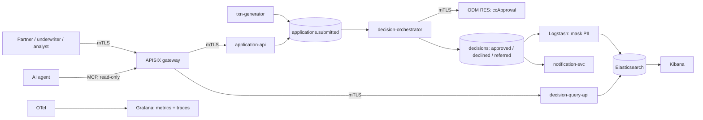

# Maple Northern Bank — Credit Card Decisioning Platform

[](https://github.com/JJ1006/cc-decisioning-platform/actions/workflows/ci.yml)
[](https://github.com/JJ1006/cc-decisioning-platform/actions/workflows/security.yml)
[](https://github.com/JJ1006/cc-decisioning-platform/actions/workflows/rules-gate.yml)
[](https://github.com/JJ1006/cc-decisioning-platform/releases)
[](LICENSE)
[](https://scorecard.dev/viewer/?uri=github.com/JJ1006/cc-decisioning-platform)

A free-to-run demo of how a large Canadian bank (fictitious) could approve credit cards in real time, with the controls a regulated bank needs.
**IBM ODM** decides, **Kafka** carries every step, **Elasticsearch** and **Kibana** remember and show the business, an **APISIX** gateway with **mutual TLS** is the only door,
**Grafana** shows metrics and traces, **Helm + Argo CD** deploy it to kind or OpenShift, and two **MCP servers** let an AI agent explain a decision. A golden dataset with an independent oracle
gates every rule change, and an agent eval proves the AI cannot decide.

> **Principle:** ODM is the deterministic system of record. An LLM never makes or overrides a credit decision ([ADR-0007](docs/adr/0007-llm-never-decides.md)).
>
> ⚠ **ODM licence:** IBM ODM for Developers is *not* open source and is for development and evaluation only. It is pulled at run time and never redistributed. Read [NOTICE](NOTICE).
>
> All data is synthetic. "Maple Northern Bank" is fictitious. This is not production software: [docs/limitations.md](docs/limitations.md).



More diagrams (C4, sequence of one application, deployment views, trust boundaries): [docs/architecture](docs/architecture/README.md).

## Quickstart (5 minutes after the first image pull)

Prerequisites: Docker Desktop with 6.5 GB or more for its VM (Rosetta on), JDK 21, Maven, uv, pre-commit, gh. `make bootstrap` checks them.

```bash
make bootstrap                    # tools, Docker memory, Rosetta
make pki                          # private CA and certificates (gitignored)
make up PROFILE=core,edge         # builds, starts, waits until healthy, deploys the rules if ODM lost them
make demo                         # 1000 synthetic applications, topic and index counts, PASS/FAIL checks
make api-call CLIENT=analyst P=/v1/stats/latency      # through the gateway with a client certificate
```

Add `analytics` for Kibana and the query API (`PROFILE=core,analytics,edge`, about 7 GB). `make down` stops, `make down V=1` also deletes the volumes. `make help` lists every target;
`make verify` is the full local check (build, tests, contracts, pipelines, lint, pins, runbooks, evals that need no model).
The ODM developer image loses its rules on restart, so `make up` runs `scripts/ensure-rules.sh`.

## Compose profiles (8 GB Mac: never run everything at once)

| Profile | Contents | ~RAM |
|---|---|---|
| `core` | Kafka, ODM, orchestrator, generator, notifier, Elasticsearch, Logstash, Filebeat | 5.5 GB |
| `analytics` | + Kibana ([dashboards, alerts](docs/kibana.md)), kafka-ui, query API | +1.3 GB |
| `obs` | + Grafana, Prometheus, Tempo, Alertmanager, collector, exporters ([docs](docs/observability.md)) | +0.6 GB |
| `edge` | + APISIX gateway (mTLS on :8443), application-api | +0.6 GB |
| `mcp` | + two MCP servers for AI agents ([docs](docs/mcp.md)) | +0.45 GB |

Kubernetes: `make kind-up PROFILE=lite` (7 GB VM, compose stopped) or `full` (12 GB+); `make argocd-up ENV=kind-lite`; `make ocp-render` for OpenShift ([docs](docs/deploy-kubernetes.md), [GitOps runbook](docs/runbooks/gitops.md)).

## Screenshots

| Kibana: executive | Kibana: risk and fairness |
|---|---|
|  |  |

| Grafana: trace of one application | Grafana: service graph |
|---|---|
|  |  |

More in [docs/images](docs/images). The Argo CD and underwriter-copilot screens are shown live in the [demo script](docs/demo-script.md) (they need a cluster and a Claude session).

## What is fake and what is real

| Fake | Real |
|---|---|
| The bank, every applicant, every score (no credit bureau), the mail (a topic), the credit policy (invented to exercise the machinery) | IBM ODM 9.5 evaluating a real rule set in Decision Center and RES |
| ODM's database (Derby, dev image, loses rules on restart) | Kafka transactions, retries, dead letters, ACLs; Elasticsearch roles and masking |
| The scale (one laptop, one node) | Mutual TLS on every hop, the gateway identity model, the audit trail, the SLOs and alerts with runbooks |
| Compliance mapping (not legal advice) | The golden-dataset regression gate, mutation proof, champion/challenger what-if, agent safety evals (23/23) |

## Documentation

| Topic | Documents |
|---|---|
| Start here | [PLAN](docs/PLAN.md) (phases), [architecture](docs/architecture/README.md), [demo script](docs/demo-script.md), [limitations](docs/limitations.md), [backlog](docs/backlog.md) |
| Decisions | [ADRs 0001 to 0014](docs/adr) (ODM licence, Kafka, ELK ingestion, APISIX, LGTM, MCP, LLM never decides, mTLS, gateway identity, Kubernetes, GitOps) |
| Rules and data | [rules catalog](docs/rules-catalog.md), [rules README](rules/README.md), [data model](docs/data-model.md), [Kafka topics](docs/kafka-topics.md), [contracts](contracts) |
| APIs | [API docs](docs/api/README.md) ([application-api](docs/api/application-api.yaml), [decision-query-api](docs/api/decision-query-api.yaml)), [Apigee mapping](docs/apigee-mapping.md), [gateway](gateway/apisix/README.md) |
| Security and privacy | [mutual TLS](docs/security-mtls.md), [threat model](docs/security/threat-model.md), [data classification](docs/privacy/data-classification.md), [compliance](docs/compliance.md), [SECURITY](SECURITY.md) |
| Analytics and ops | [Kibana](docs/kibana.md), [observability](docs/observability.md), [runbooks](docs/runbooks/README.md) (alerts, local setup, GitOps, Dependabot, Decision Center API, event services) |
| AI | [MCP servers](docs/mcp.md), [underwriter copilot](docs/underwriter-copilot.md) |
| Evidence | [evals](docs/evals.md) (golden dataset, rule regression, what-if, agent evals, k6, chaos) |
| Deploy | [Kubernetes and OpenShift](docs/deploy-kubernetes.md), [GitOps runbook](docs/runbooks/gitops.md) |

## Contributing and releases

[CONTRIBUTING](CONTRIBUTING.md), [Code of conduct](CODE_OF_CONDUCT.md), [SECURITY](SECURITY.md). Conventional Commits, squash merge only; versions and [CHANGELOG](CHANGELOG.md) come from release-please, never by hand.
Release images (multi-arch, signed with cosign, SBOM attached) are on GHCR; ODM is never in them.
