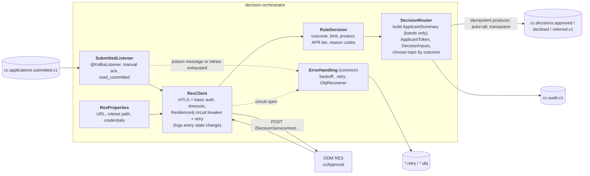
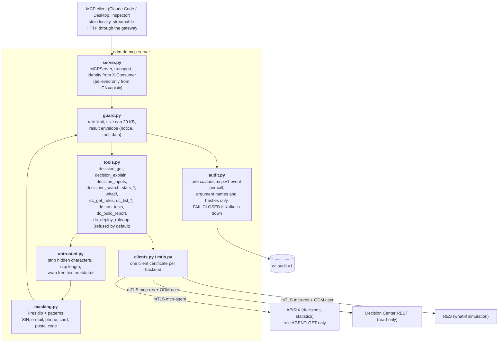

# C4: components

## decision-orchestrator

The only service that asks ODM for a decision. One input topic, three output topics, one audit topic.

Rules of the box: the listener acknowledges only after the decision events are committed; the same `applicationId` always lands on the same partition; the decision event carries the ruleset version and deployment time; exact inputs go to the restricted `cc-decision-inputs` index only (`applicantSummary` has bands).

## odm-dc MCP server

Our MCP server for AI agents. Every tool passes through the same guard; nothing in it can write a decision.

The guardrail is structural, not a prompt: there is no tool that approves, declines or edits a decision, and `dc_deploy_ruleapp` additionally needs a token only a human holds ([ADR-0007](../adr/0007-llm-never-decides.md), [ADR-0012](../adr/0012-agent-access.md)). The eval proof is in [docs/evals.md](../evals.md) (23/23 safety cases).
