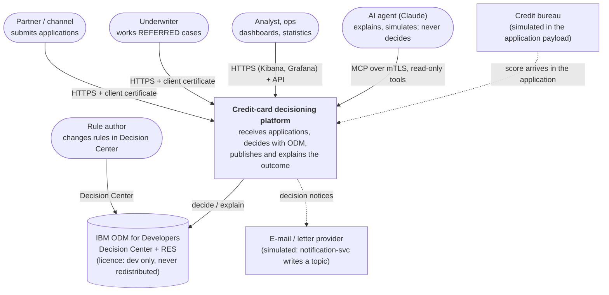
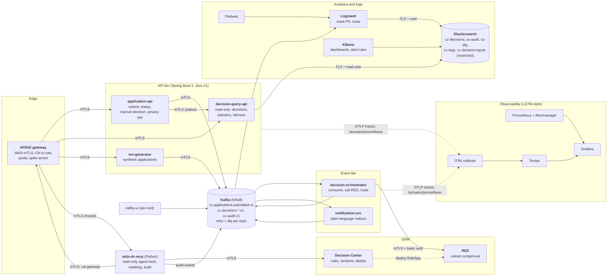

# C4: system context and containers

## Level 1: system context

Everything outside the box is synthetic or simulated: no real bureau, no real mail, no real customer. See [limitations](../limitations.md).

## Level 2: containers

| Container | Tech | Owns | Never does |
|---|---|---|---|
| APISIX | Apache APISIX 3.13, standalone YAML | identity from the client certificate, roles, rate limits | terminate TLS before the certificate is read |
| application-api | Spring Boot | the submit contract, idempotency, manual decisions | decide anything; read personal data back |
| decision-orchestrator | Spring Boot, Kafka, Resilience4j | the only call to RES; retry, DLQ, circuit breaker | override an ODM answer |
| decision-query-api | Spring Boot | read access to Elasticsearch behind roles | write |
| notification-svc | Spring Boot | the notice wording from reason codes | send real mail |
| Logstash | 8.19 | PII masking and routing to indices | keep an unmasked copy outside the DLQ topics |
| odm-dc-mcp | Python 3.13, FastMCP | masked, audited, read-only tools | approve, decline, change a limit, deploy without a human token |
| ODM | IBM ODM 9.5 dev image | rules, versions, the decision | persist rules across restarts (Derby, dev image) |

Detail: [components.md](components.md), [sequence-application.md](sequence-application.md), [trust-boundaries.md](trust-boundaries.md).
