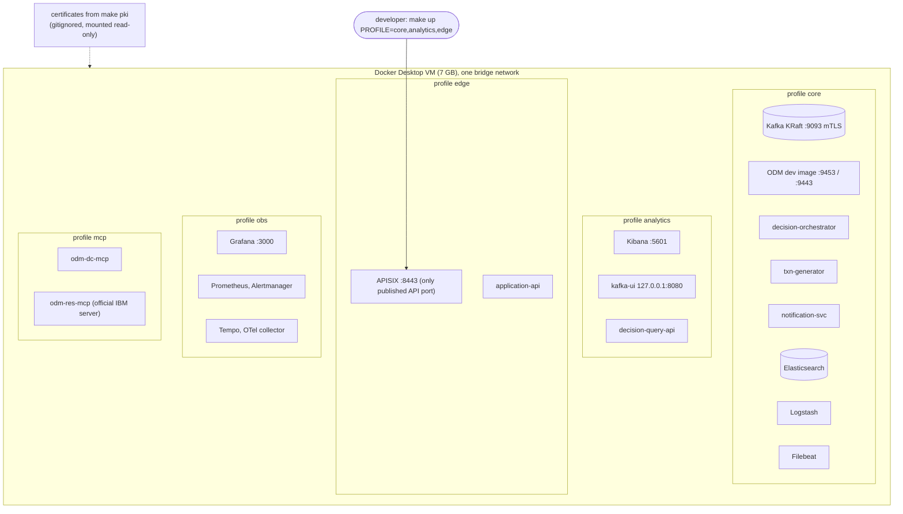
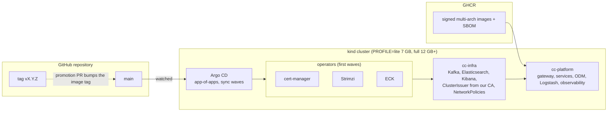
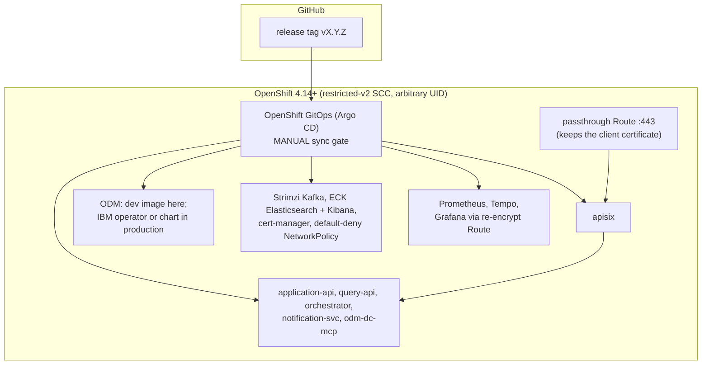

# Deployment views

One set of images and one set of configuration files, three ways to run them. Sizing: [README](../../README.md#compose-profiles-8-gb-mac-never-run-everything-at-once).

## 1. Docker Compose (the laptop)

Start/stop, profiles and memory limits (`mem_limit` on every service): [local-setup](../runbooks/local-setup.md). Never run everything at once on 8 GB.

## 2. kind with Argo CD (GitOps rehearsal)

`kind` takes the laptop, so the compose stack must be down first. Runbook: [gitops](../runbooks/gitops.md); decisions: [ADR-0013](../adr/0013-kubernetes-deployment.md), [ADR-0014](../adr/0014-gitops-argocd.md). CI proves it on every pull request labelled `kind` (`kind-smoke`).

## 3. OpenShift (the target)

Never synced on a real cluster yet: the manifests are rendered (`make ocp-render`), schema-checked and policy-linted. Honest status in [limitations](../limitations.md).

## Differences that matter

| | Compose | kind + Argo CD | OpenShift |
|---|---|---|---|
| Certificates | `make pki` files | cert-manager signs with the same CA; Kafka uses Strimzi's own CAs | same as kind; operator `startingCSV` not yet pinned |
| Kafka | Apache Kafka 3.9.2 | Strimzi, Kafka 4.x | Strimzi, Kafka 4.x |
| Secrets | generated, gitignored files | `scripts/k8s-secrets.sh` | by hand; External Secrets is backlog |
| Gateway exposure | published port 8443 | NodePort 30443 | passthrough Route |
| Pod security | container defaults | `restricted` (Filebeat namespace `privileged`) | SCC; Filebeat off |
| Promotion | none | automatic from `main` | manual sync of a release tag |
