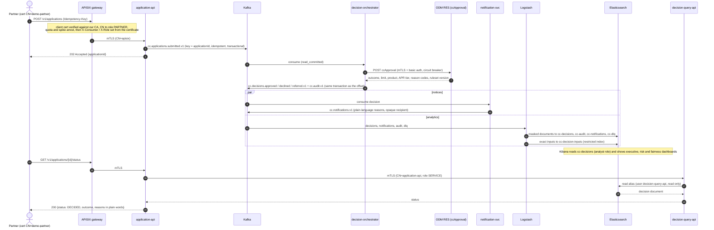

# Sequence: one application, end to end

A partner submits one application; the platform decides it, tells the applicant, makes it visible to analysts, and answers the status question. Every arrow between boxes is mutual TLS (the elastic hops use TLS plus a least-privilege user). Topic names: [kafka-topics](../kafka-topics.md).

## When something goes wrong

| Step | Failure | What happens |
|---|---|---|
| 3 | Kafka down | `application-api` cannot publish and does not accept; nothing is acknowledged that could be lost (chaos drill: acknowledged == decided + dead-lettered) |
| 6 | ODM down or slow | retries with backoff, then the circuit breaker opens (logged on every state change); records go to `.retry`, then `cc.applications.submitted.v1.dlq`; an alert fires ([DeadLetterRate](../runbooks/alerts/DeadLetterRate.md)) |
| 6 | ruleset missing after an ODM restart | RES answers 404; dead letters; `make up` runs `scripts/ensure-rules.sh` |
| 8 | poison message (bad JSON, contract violation) | skips retries, goes straight to the dead letter topic |
| 11 | Logstash killed | its persistent queue and the Kafka offsets carry the rest (chaos drill) |

A decision that needs a human (REFER) is later settled by an underwriter through `application-api` (`cc.decisions.manual.v1`); the AI copilot may explain it through the MCP server but cannot record or change it ([underwriter-copilot](../underwriter-copilot.md)).
