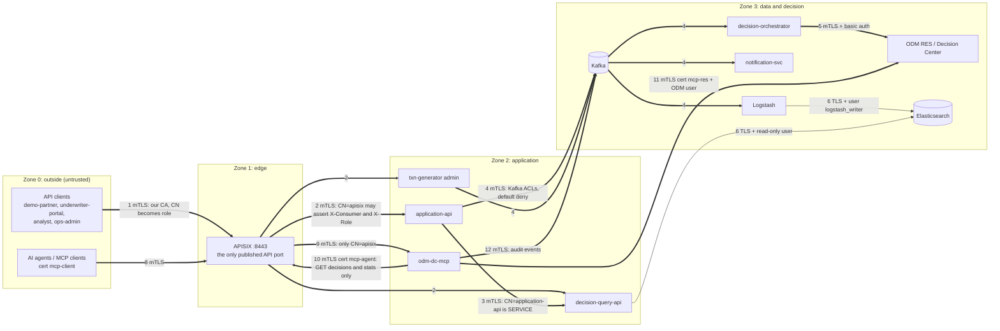

# Trust boundaries and mutual-TLS hops

Thick arrows are mutual TLS (both sides present a certificate from the one private CA of `make pki`, or cert-manager's issuer using that CA on Kubernetes). Thin arrows are TLS plus a least-privilege user (Elasticsearch's certificate login needs a paid licence). Hop numbers are those of [docs/security-mtls.md](../security-mtls.md). Not on the diagram, by design: Kibana and Grafana (HTTPS with logins), `kafka-ui` (loopback only, dev tool), the plain-HTTP management port of the Spring services (inside the network, not published), the KRaft controller listener (not published).

## Where the boundaries are enforced

| Boundary | Enforced by | Proof |
|---|---|---|
| 0 to 1 | no certificate or a foreign CA: the handshake is refused; CN to role; quota and spike arrest | `make verify-mtls` (checks from the outside, including "no cert is rejected") |
| 1 to 2 | the upstream checks the CN list (`apisix` only) before it believes `X-Consumer` and `X-Role`; the gateway deletes client-supplied copies | filter tests in the API services |
| 2 to 3 | Kafka ACLs (principal = CN, default deny); Elasticsearch roles (`logstash_writer` writes, `decision-query-api` reads, restricted `cc-decision-inputs`) | ACL table in [security-mtls](../security-mtls.md); `make verify-mtls` |
| agent to platform | the agent's identity is `mcp-agent` (role AGENT, GET only); results are masked, size-capped and audited; no write tool exists | tool-level evals (20), agent evals (safety 23/23) |
| personal data | Logstash masks before Elasticsearch; exact inputs only in the restricted index; short retention on the topics that hold identifiers | Logstash pipeline tests, [data classification](../privacy/data-classification.md) |

The full hop table (who presents what, what is checked) is [docs/security-mtls.md](../security-mtls.md); the threats are in [threat-model](../security/threat-model.md).
