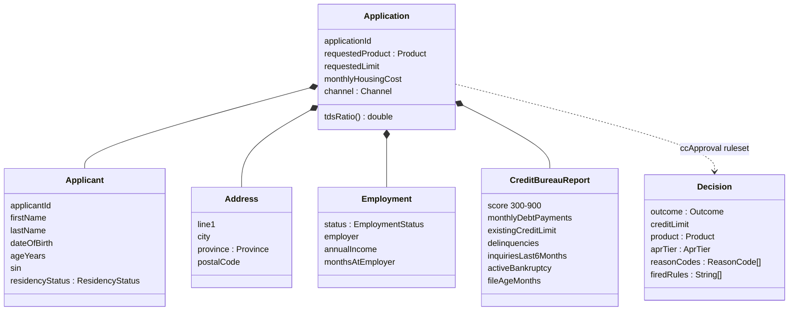

# Data model

Source of truth: JSON Schemas in [`contracts/`](../contracts) (events) and the Java XOM in [`rules/xom`](../rules/xom) (rule input/output).
The XOM contains no prohibited grounds (gender, ethnicity, marital status, religion). Age is used only for the provincial age-of-majority check.

## Event envelope

Every Kafka value is JSON with this envelope (`contracts/envelope.schema.json`):

| Field | Type | Notes |
|---|---|---|
| `eventId` | uuid | unique per event |
| `correlationId` | string | follows one application end to end; also the `X-Correlation-Id` header and the log MDC key |
| `eventType` | string | equals the topic name, e.g. `cc.decisions.approved.v1` |
| `schemaVersion` | int | bump on breaking payload change; add a `.v2` topic |
| `occurredAt` | date-time | UTC |
| `producer` | string | service name |
| `payload` | object | per-event schema |

## Schemas

| Schema | Payload (Java) |
|---|---|
| `application-submitted` | `ApplicationSubmittedPayload` |
| `decision-approved` / `declined` / `referred` | `DecisionPayload` (outcome fixed per schema) |
| `decision-manual` | `ManualDecisionPayload` |
| `notification` | `NotificationPayload` |
| `audit` | `AuditPayload` |
| `dlq` | `DlqPayload` |

Shared definitions (enums, `application`, `decisionPayload`) live in `defs.schema.json` and mirror the XOM enums.
`DecisionPayload.applicantSummary` carries only non-identifying attributes (province, age band, score, TDS, income) for analytics and fairness reporting.

## Validation

- `scripts/validate-contracts.py` validates every `contracts/examples/*.example.json` against its schema (CI).
- `ContractRoundTripTest` in `common-lib` validates each example, deserializes it into the DTO, serializes it back and checks it is unchanged and still valid.
