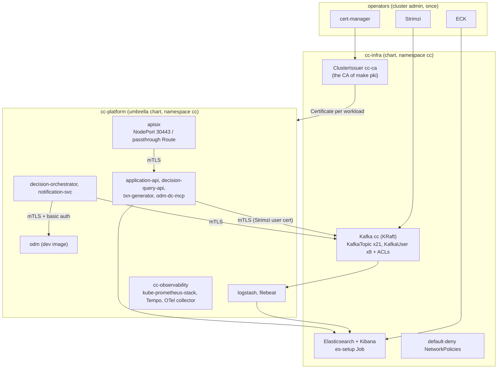

# Kubernetes and OpenShift (P10)

The platform of the compose stack, as Helm charts: `kind` on a laptop, OpenShift 4.14+ for the real thing. Same images, same configuration files
(copied in by `scripts/helm-sync.sh`, never edited), same mutual TLS on every hop, same resource limits (taken from `mem_limit` in
`deploy/compose/docker-compose.yml`). Fictitious bank, synthetic data.



## Layout

| Path | What |
|---|---|
| `deploy/helm/cc-lib` | library chart: Deployment, Service, ConfigMap, Certificate, HPA, PDB, NetworkPolicy, ServiceMonitor, Route or Ingress |
| `deploy/helm/charts/<name>` | one chart per workload: `txn-generator`, `decision-orchestrator`, `notification-svc`, `decision-query-api`, `application-api`, `odm-dc-mcp`, `apisix`, `odm`, `logstash`, `filebeat`, `cc-observability` |
| `deploy/helm/cc-platform` | umbrella (`Chart.lock` committed) with `values.yaml`, `values-kind-lite.yaml`, `values-kind-full.yaml`, `values-openshift.yaml` |
| `deploy/helm/cc-infra` | installed first: Strimzi Kafka, topics, users and ACLs (generated from the docs), ECK Elasticsearch/Kibana, cert-manager issuer, default-deny policies |
| `deploy/kind/` | `cluster.yaml` (one node, `localhost:8443` is the gateway), `versions.env` (pinned operator charts) |
| `scripts/kind.sh`, `scripts/k8s-secrets.sh`, `scripts/ocp-render.sh` | what the `make kind-*` and `make ocp-render` targets run |
| `scripts/helm-sync.sh`, `scripts/gen-k8s-kafka.py` | copy the compose configuration into the charts; generate topics and users. CI fails when a copy is stale |

Each service chart is a few lines: `templates/all.yaml` includes `cc-lib.all` (the `cc-lib` templates are copied into every workload chart by `scripts/helm-sync.sh`, so the charts have no dependencies and Argo CD can render them; [GitOps](runbooks/gitops.md)), `values.yaml` holds the image, port, limits, probes, certificate,
Kafka user and network policy of that workload. A change to how every workload is deployed is one change in `cc-lib`.

### Compose to Kubernetes

| Compose | Kubernetes |
|---|---|
| `kafka` (apache/kafka 3.9.2) + `topic-init` | Strimzi `Kafka` cc, `KafkaNodePool`, 21 `KafkaTopic` (from `docs/kafka-topics.md`), Kafka 4.3 (Strimzi 1.x runs 4.x) |
| certificates of `scripts/pki.sh` per service | cert-manager `Certificate` per workload from the same CA, PKCS12 stores (JKS for ODM, PEM for Python and Logstash) |
| `elasticsearch`, `es-setup`, `kibana` | ECK `Elasticsearch` (HTTP certificate from cert-manager), `Kibana`, the unchanged `es-setup.sh` as a Job |
| `odm` | `charts/odm`: the same dev image and Liberty overrides (`mtls.xml`, `metrics.xml`) |
| `apisix` | `charts/apisix`: the same declarative `apisix.yaml.tmpl`, `entrypoint.sh` and `config.yaml`, certificates inserted at start |
| `logstash`, `filebeat` | `charts/logstash` (same pipelines, endpoints from the environment), `charts/filebeat` (DaemonSet, Kubernetes autodiscover) |
| `obs` profile | `charts/cc-observability` (its own release, with Filebeat): kube-prometheus-stack, Tempo, the OTel collector with the same pipeline, the 8 dashboards and the alert rules as `PrometheusRule` |
| `mcp` profile | `charts/odm-dc-mcp` (the official ODM MCP server stays a local stdio tool, [mcp](mcp.md)) |
| `mem_limit` | `resources.limits.memory`; requests are about 60-75 % of it so everything schedules on a small cluster |
| healthcheck | `startupProbe`, `livenessProbe`, `readinessProbe` on the management port |

## Try it on kind

Needs Docker Desktop, `kind`, `kubectl`, `helm` (`brew install kind kubectl helm`), and the compose stack **down** (`make down V=1`): a 7 GB
Docker VM cannot hold both.

```bash
make pki                          # the CA (once); kind-up runs it if missing
make kind-up PROFILE=lite         # cluster, cert-manager, Strimzi, secrets, images, cc-infra, cc-platform
make kind-deploy-rules            # port-forward ODM, scripts/deploy-dc.sh
make kind-demo                    # 200 applications through https://localhost:8443, counts per topic from the broker pod
make kind-down
```

| Profile | Runs | Docker VM |
|---|---|---|
| `lite` | Kafka (Strimzi), ODM, orchestrator, generator, notification-svc, application-api, APISIX. No Elasticsearch, no Logstash/Filebeat, no observability, so the status and decision reads of the gateway answer 502 | 7 GB |
| `full` | lite plus ECK Elasticsearch and Kibana, Logstash, Filebeat, query API, MCP server, kube-prometheus-stack, Tempo, collector, ingress-nginx | 12 GB or more |

The gateway is a NodePort mapped to `localhost:8443`; use it like the compose one (`scripts/api-call.sh ops-admin /admin/generator/status`).
Kibana and Grafana in `full`: `https://kibana.localtest.me:5443`, `https://grafana.localtest.me:5443` (`localtest.me` resolves to 127.0.0.1).
Images are built from this repository and loaded into the cluster as `ghcr.io/jj1006/cc-<service>:dev`; to use published images set
`global.image.tag` to a commit SHA or release (below).

## Pod security (every workload)

`runAsNonRoot`, **no fixed UID, GID or fsGroup**, `allowPrivilegeEscalation: false`, all capabilities dropped, `seccompProfile: RuntimeDefault`,
`readOnlyRootFilesystem: true` with an `emptyDir` at each path that is written (`/tmp`, ...), no service account token. The namespace carries
Pod Security `restricted` (kind lite proves the charts pass it). Key and trust stores are projected from Secrets with mode 0444, so any assigned UID can read
them without an fsGroup; they live in a tmpfs of that pod only.

Documented exceptions (`.kube-linter.yaml` and annotations in the charts):

| Workload | Exception | Why |
|---|---|---|
| `odm` | writable root file system | the image's start script rewrites `/config` (TLS configuration, key and trust stores). Dev image only |
| `filebeat` | root, hostPath, writable registry | reads the node's container logs. Off on OpenShift (OpenShift Logging collects there); on kind the namespace is `privileged` in `full` only |
| `apisix` | needs `runAsUser` on plain Kubernetes | the image's user is the *name* `apisix`, which `runAsNonRoot` cannot verify. `values-kind-*.yaml` sets 636 (the image's own uid); `values-openshift.yaml` sets none and the SCC assigns one |
| upstream charts (Prometheus stack, Tempo, collector) | not linted | the vendors' charts; `kubeconform` still validates them |

## Network

`cc-infra` creates `default-deny-all` (ingress and egress) and DNS. Everything else is an explicit allow: the workload charts carry theirs
(`networkPolicy.ingress` / `egress`, plus the Prometheus scrape of the management port), `cc-infra` the ones for Kafka, Elasticsearch, Kibana and the
setup job. The gateway is the only workload open to any source; the client certificate decides who gets in. Services accept only the gateway's
certificate (`CN=apisix`) on top, exactly as in [security-mtls](security-mtls.md). kind's default CNI enforces NetworkPolicy since kind 0.27; on
OpenShift OVN-Kubernetes does.

## Certificates

* **Platform CA** = the CA of `make pki`, loaded by `scripts/k8s-secrets.sh` into `cert-manager/cc-ca-keypair`; the `ClusterIssuer cc-ca` signs with it.
  On OpenShift use the issuer of your organisation (Vault, ACME, ...) and set `global.pki.issuer` and `pki.issuer`.
* A `Certificate` per workload (CN = service name, SANs `name`, `name.ns`, `name.ns.svc`, `localhost`), RSA 2048 PKCS8, 90 days, renewed 15 days before.
  The same CN rules as compose apply (`apisix`, `application-api`, `mcp-agent`, ...). Rotation is cert-manager's; pods read stores at start, so use a
  restarter (Reloader) or `kubectl rollout restart`.
* **Kafka uses Strimzi's own CAs**, not the platform CA: a cluster CA for the brokers and a clients CA for the users. The compose stack has one CA for everything.

| | compose | Kubernetes |
|---|---|---|
| Broker certificate | `kafka` from `pki.sh` | Strimzi cluster CA, renewed by the operator |
| Client certificate of a service | `<service>.p12` from `pki.sh` | secret `<service>` written by the User Operator (`user.p12`, `user.password`, also `user.crt`/`user.key`) |
| Trust for Kafka | `truststore.p12` (platform CA) | `cc-cluster-ca-cert` (`ca.p12`, `ca.password`, `ca.crt`) |
| Principal | certificate subject | `CN=<KafkaUser name>` |
| ACLs | not enabled | `authorization: simple`; the ACLs are generated from the table in [security-mtls](security-mtls.md#kafka-clients-and-acls-ready-for-strimzi-in-p10) |
| Store passwords | one `PKI_PASSWORD` | two (user store, CA store): the services read `KAFKA_STORE_PASSWORD` and `KAFKA_TRUSTSTORE_PASSWORD` |

The Java services and Logstash read these through `KAFKA_*` variables; `odm-dc-mcp` uses the PEM files (`KAFKA_CA_FILE`, `KAFKA_CERT`, `KAFKA_CERT_KEY`).
Elasticsearch's HTTP certificate and everything else (gateway, services, ODM, Grafana, Kibana) come from the platform CA, so clients keep one trust anchor.

## Secrets

Nothing secret is in git. On kind `scripts/k8s-secrets.sh` creates them from the compose secrets or generates them:

| Secret | Namespace | Keys | Read by |
|---|---|---|---|
| `cc-ca-keypair` | cert-manager | `tls.crt`, `tls.key` (the platform CA) | the ClusterIssuer |
| `cc-pki-password` | cc | `password` | every cert-manager store; services, ODM |
| `cc-odm-credentials` | cc | `RES_USERNAME`, `RES_PASSWORD`, `DC_USERNAME`, `DC_PASSWORD` (the fixed demo users of the ODM dev image) | orchestrator, odm-dc-mcp |
| `cc-es-passwords` | cc | `KIBANA_`, `LOGSTASH_WRITER_`, `QUERY_API_`, `ANALYST_`, `OPS_`, `OBS_EXPORTER_`, `GRAFANA_ES_PASSWORD` | es-setup Job, Logstash, query API |
| `cc-kibana-keys`, `cc-grafana`, `cc-grafana-env` | cc | encryption key; Grafana admin; logs-reader password | Kibana, Grafana |

For OpenShift or production create the same names with **Sealed Secrets** (commit the sealed form, the controller decrypts in the cluster) or the
**External Secrets Operator** (an `ExternalSecret` per row, backed by Vault, AWS/GCP/Azure secret managers or the IBM Secrets Manager). The charts only
reference names, so nothing else changes.

## Images and supply chain

`.github/workflows/images.yml` builds each service for linux/amd64 and linux/arm64 and pushes `ghcr.io/jj1006/cc-<service>:<commit sha>` (and `:<version>` on
a `v*` tag). Every image is signed with **cosign keyless** (GitHub OIDC, nothing to store) and has a **Syft** SBOM attached as a cosign attestation:

```bash
cosign verify ghcr.io/jj1006/cc-txn-generator:<sha> \
  --certificate-identity-regexp 'https://github.com/JJ1006/cc-decisioning-platform/.*' \
  --certificate-oidc-issuer https://token.actions.githubusercontent.com
cosign verify-attestation --type spdxjson ghcr.io/jj1006/cc-txn-generator:<sha> --certificate-identity-regexp '...' --certificate-oidc-issuer ...
```

Values reference GHCR (`global.image.registry: ghcr.io`, `repository: jj1006/cc-<service>`); pin `global.image.tag` to a SHA, or a digest through `image.tag`.
Third-party images (APISIX, Logstash, Filebeat, ODM) are referenced by tag; the ODM image comes from IBM's registry and is never re-published.

## CI (`.github/workflows/helm.yml`)

* **lint** on every change to the charts or the files they copy: copies in sync (`scripts/helm-sync.sh --check`), `helm lint` of all charts, `helm template` with
  `kind-lite`, `kind-full` and `openshift`, **kubeconform** `--strict` on Kubernetes 1.30 with the CRD schemas of Strimzi, ECK, cert-manager and the Prometheus
  Operator (datreeio catalog) and of the OpenShift Route (`deploy/helm/schemas`), **kube-linter** with `.kube-linter.yaml`. Locally: `make lint-helm`.
* **kind-smoke** (manual `workflow_dispatch`, or a pull request labelled `kind`): `make kind-up PROFILE=lite`, `kind-deploy-rules`, `kind-demo`, and the
  assertion that decisions were produced. A GitHub runner has 16 GB.

## OpenShift

```bash
make ocp-render                    # out/openshift/cc-infra.yaml and cc-platform.yaml, no cluster needed (CA=ca.crt embeds the CA in the Routes)
```

1. **Operators** (OperatorHub, cluster admin): *cert-manager Operator for Red Hat OpenShift*, *Strimzi* (or AMQ Streams), *Elasticsearch (ECK)*. Install them for
   all namespaces or for `cc`. ECK needs `--set-default-security-context=auto-detect` (the default of the OperatorHub install).
2. **Namespace and secrets**: `oc new-project cc`; create the secrets of the table above (Sealed or External Secrets); the platform CA keypair goes to the
   `cert-manager` operand namespace (`cc-ca-keypair`), or define your own `ClusterIssuer` and set `global.pki.issuer` / `pki.issuer`.
3. **Install**:

   ```bash
   helm upgrade --install infra deploy/helm/cc-infra -n cc -f deploy/helm/cc-infra/values-openshift.yaml --set-file pki.caPem=ca.crt
   oc -n cc wait kafka/cc --for=condition=Ready --timeout=15m
   helm upgrade --install cc deploy/helm/cc-platform -n cc -f deploy/helm/cc-platform/values-openshift.yaml \
     --set global.image.tag=<sha or release> --set-file global.pki.caPem=ca.crt
   oc get route apisix
   ```

4. **What is different from kind**: Routes instead of Ingress (`global.exposure: route`); the gateway Route is **passthrough**, because re-encrypting would end
   the client's mutual TLS at the router and the roles come from the client certificate. Kibana and Grafana use **re-encrypt** with the platform CA as destination
   CA. No UID, GID or fsGroup is set anywhere, so `restricted-v2` assigns them; no ImageStreams (the images come from GHCR; mirror them with
   `oc import-image` if the cluster has no egress). Filebeat is off: use *OpenShift Logging* (Vector) to forward to Logstash. ODM is the **dev image**:
   for production use the IBM ODM operator / Helm chart (entitled image, real database, [ADR-0001](adr/0001-odm-dev-licence.md)) and point
   `RES_BASE_URL` and the Decision Center URLs at it (`odm.enabled: false`).
5. **Monitoring**: `cc-observability` is off. Enable user workload monitoring (`enableUserWorkload: true` in `cluster-monitoring-config`); it reads the
   `ServiceMonitor`s the charts create (`serviceMonitor.enabled`) and the NetworkPolicies already allow the scrape from
   `openshift-user-workload-monitoring`. Dashboards: import `observability/grafana/dashboards` into the Grafana of your choice. Tempo and the OTel collector can
   be installed alone with `--set cc-observability.kube-prometheus-stack.enabled=false --set cc-observability.enabled=true`.
6. **Sizing**: three Kafka brokers and three Elasticsearch nodes in `values-openshift.yaml`; set storage classes. Replace `replicas`, enable `hpa` and `pdb`
   per workload (every chart has them).

### Where to run OpenShift

| Target | Notes |
|---|---|
| **OpenShift Local (CRC)** / **OKD** single node | cluster admin, operators install. Needs about 16 GB RAM and 4 vCPU for the OpenShift itself plus the platform: give the VM 24 GB for the lite set, more for full. Slow disk is the usual problem |
| **Red Hat Developer Sandbox** (free) | **no cluster admin**: you cannot install operators, CRDs or ClusterIssuers, and the namespace has small quotas (about 7 GB RAM, 15 GB storage, few pods). What works: `apisix`, the three Java services and `application-api` with `values-openshift.yaml` against an **external** Kafka (a managed one, with `global.kafka.bootstrap` and user secrets you create by hand) and certificates you supply as Secrets (`pki.enabled: false` and your own secret names). Not possible: Strimzi, ECK, cert-manager, network-wide policies, the ODM dev image (memory) |
| A managed OpenShift (ROSA, ARO, IBM Cloud) | the target the charts are written for |

## Limits of this phase (P10)

* **Kafka 4.3 on Kubernetes, 3.9.2 in compose.** Strimzi 1.x ships Kafka 4.x only. The Java clients are 3.9; they talk to both.
* **Own APISIX chart** instead of the upstream one: the upstream chart adds etcd and an ingress controller; the standalone, declarative gateway is the same
  file as in compose.
* Kibana saved objects and rules (`make seed-kibana`) are not applied by the charts yet ([backlog](backlog.md)); the observability stack has no
  Elasticsearch/Logstash exporters or blackbox probes yet, so the ELK dashboard and a few alerts need those before they fill.
* One Kafka broker and one Elasticsearch node on kind; `values-openshift.yaml` shows the three-node sizing but it is not load-tested.
* ODM is the dev image with Derby: the rules are lost with the pod (`make kind-deploy-rules` again).
