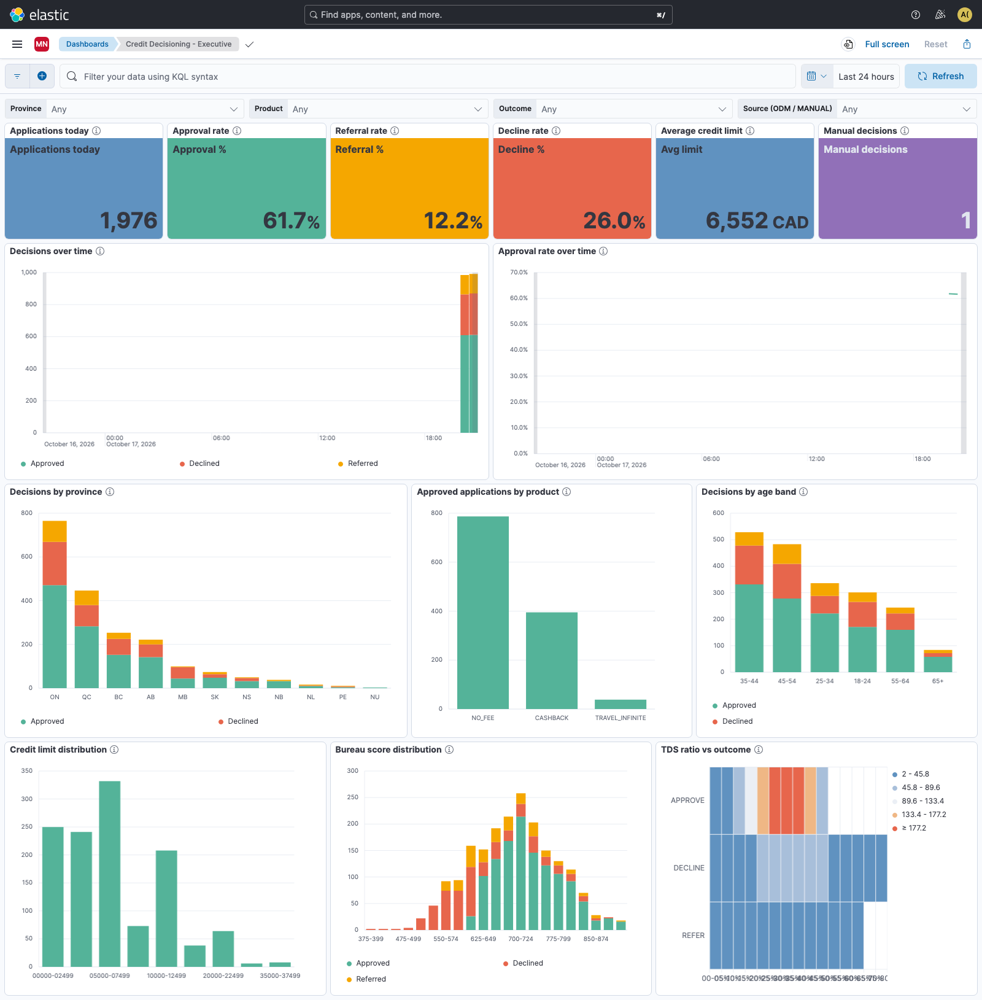
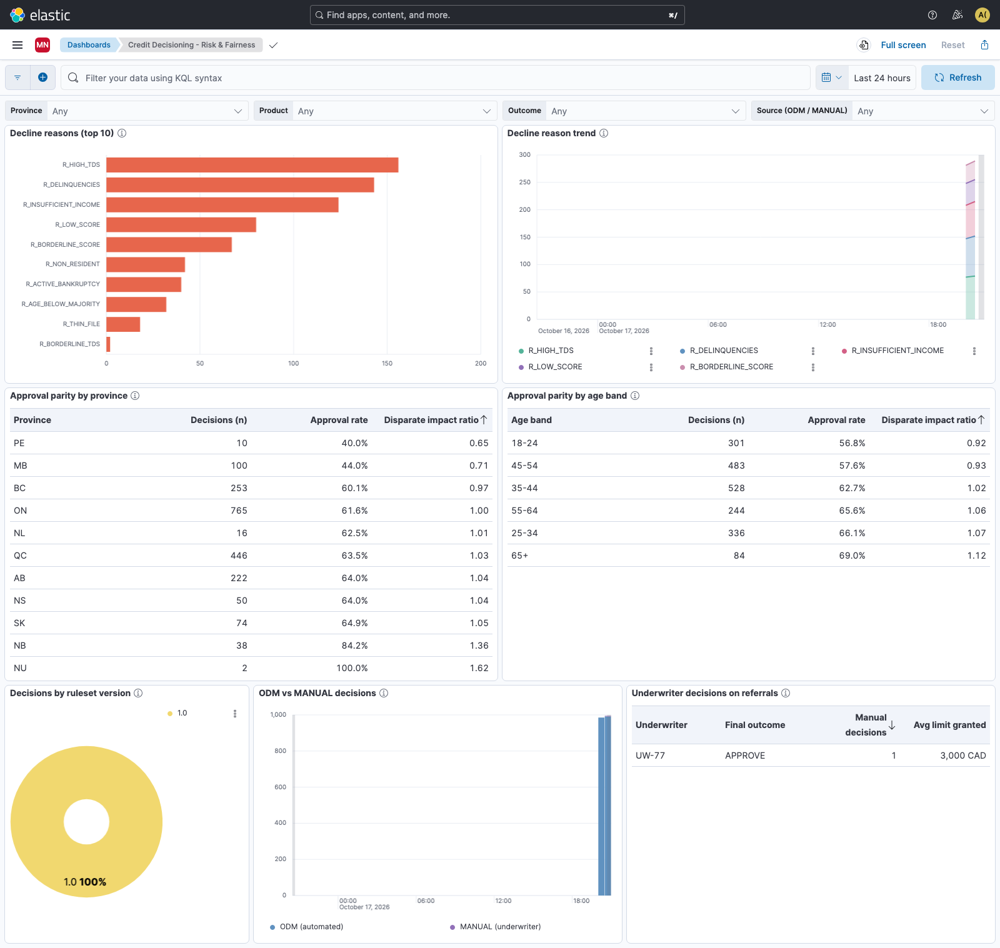
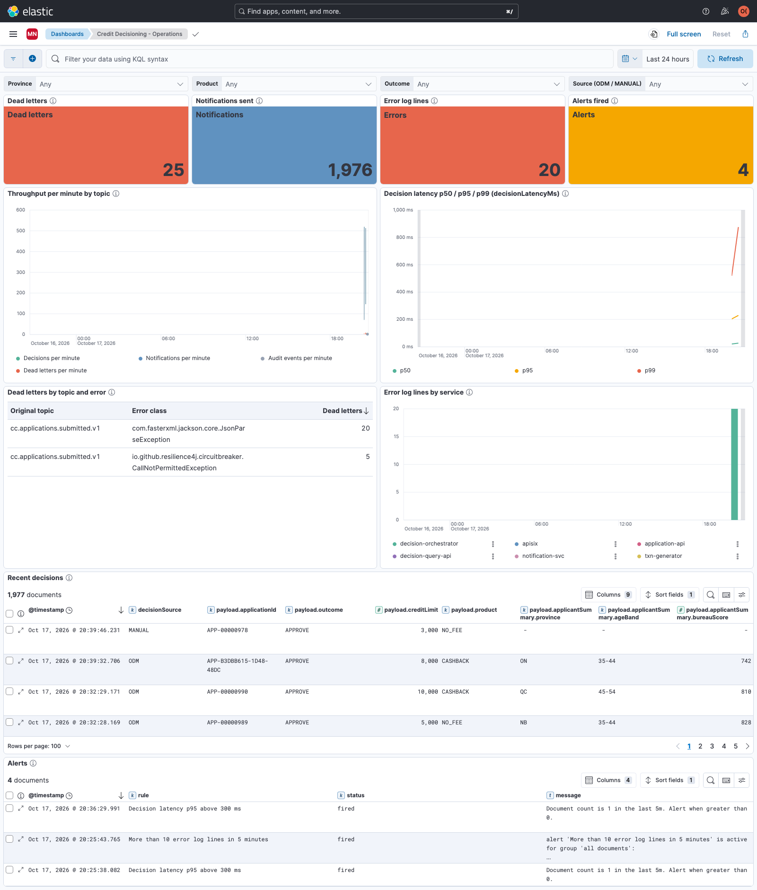
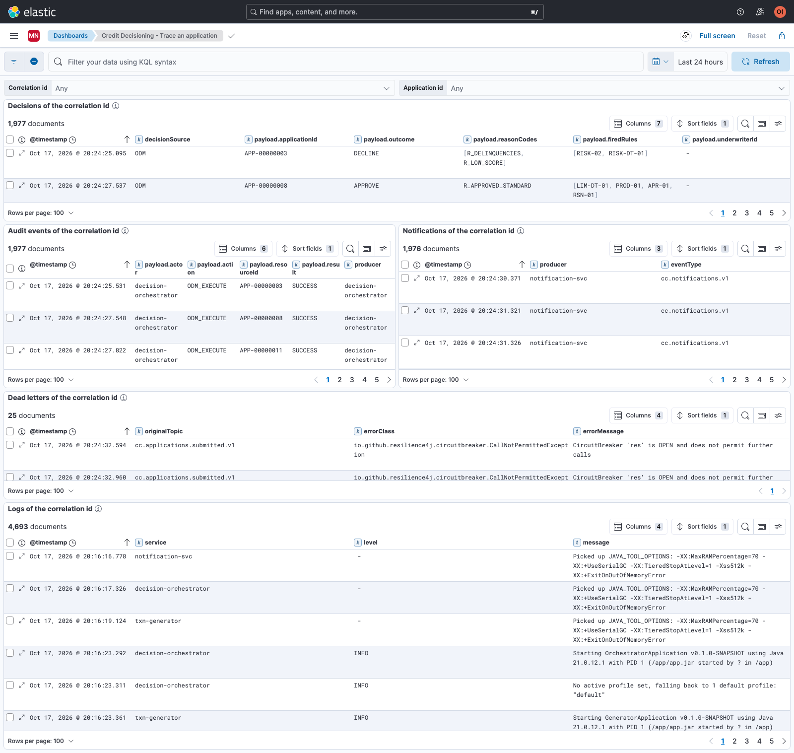

# Kibana: dashboards, alerts and access (P7)

Everything is code in `observability/kibana/` and is loaded by `scripts/seed-kibana.sh` (`make seed-kibana`; `make up` with the `analytics`
profile runs it once Kibana is healthy). The data is already PII-masked by Logstash ([event-services runbook](runbooks/event-services.md)).
Open `https://localhost:5601` (our CA signed it), space **Maple Northern** (`/s/maple-northern`).

| User | Role | Sees |
|---|---|---|
| `analyst` | `kibana_analyst` | the dashboards of the space (read only) and the data of `cc-decisions`, `cc-audit`, `cc-notifications`, `cc-dlq`; **not** `cc-logs` or `cc-alerts` |
| `ops` | `kibana_ops` | all of the above plus `cc-logs`, `cc-alerts` and the alert rules (read) |
| `elastic` | superuser | administration (`make seed-kibana` uses it) |

The passwords of `analyst` and `ops` are generated into the root env file (`ANALYST_PASSWORD`, `OPS_PASSWORD`) by `scripts/compose.sh`, and the users are created
by `scripts/es-setup.sh` together with the two roles (`deploy/es/kibana_*.role.json`: Elasticsearch index privileges and Kibana feature privileges
limited to the space). The executive and risk dashboards are meant for the analyst; the operations and trace dashboards need `ops`
(for the analyst their log and alert panels stay empty with a permission error: that is the access control working).

## Dashboards

All panels have a title and a description (the (i) next to the title). Colours are the same everywhere: **approve green, decline red, refer
amber**, manual decisions purple, volumes blue. The default time range is the last 24 hours (time picker), and four controls
filter every panel they apply to: **Province, Product, Outcome, Source (ODM / MANUAL)**; the trace dashboard has the correlation id and
application id instead. The data views have runtime fields `isApproved`, `isDeclined`, `isReferred` (1 or 0: their average is the rate) and
`scoreBand`, `limitBand`, `tdsBand` (text buckets that sort and label well).

### Credit Decisioning - Executive

For: management, analysts. Counts the automated (ODM) decisions.

| Panel | Shows |
|---|---|
| Applications today | automated decisions since midnight |
| Approval rate, Referral rate, Decline rate | share of automated decisions per outcome |
| Average credit limit | average limit of approved applications (CAD) |
| Manual decisions | decisions taken by an underwriter |
| Decisions over time | volume by outcome per interval |
| Approval rate over time | approved divided by all, per interval |
| Decisions by province / by age band | stacked by outcome |
| Approved applications by product | NO_FEE, CASHBACK, TRAVEL_INFINITE |
| Credit limit distribution | approved limits in 2,500 CAD buckets |
| Bureau score distribution | 25-point buckets by outcome |
| TDS ratio vs outcome | heat map of decisions per total debt service bucket and outcome |

The brief asked for a region map of provinces. Elastic Maps needs the Elastic Maps Service (online) for the Canada boundaries, which a
laptop demo without internet cannot rely on, so provinces are bars.

### Credit Decisioning - Risk & Fairness

For: risk, compliance. Why applications are declined and whether approval is even.

| Panel | Shows |
|---|---|
| Decline reasons (top 10) | reason codes of automated declines (one decline can have several) |
| Decline reason trend | the five most frequent reasons over time |
| Approval parity by province / by age band | decisions (n), approval rate and the **disparate impact ratio**: group rate divided by the overall rate (`(sum(isApproved)/count()) / (overall_sum(sum(isApproved)) / overall_sum(count()))`, the same definition as `/v1/stats/fairness`). Below 0.8 (four-fifths rule) deserves a look; small n gives noisy ratios, so n is a column |
| Decisions by ruleset version | which ODM ruleset version decided |
| ODM vs MANUAL decisions | automated and underwriter decisions over time |
| Underwriter decisions on referrals | manual decisions per underwriter and outcome (every one answers a REFER) |

### Credit Decisioning - Operations

For: operations (`ops`). Throughput, latency, failures.

| Panel | Shows |
|---|---|
| Dead letters, Notifications sent, Error log lines, Alerts fired | counts for the period; dead letters and alerts are zero on a healthy system |
| Throughput per minute by topic | decisions, notifications, audit events, dead letters |
| Decision latency p50 / p95 / p99 | `decisionLatencyMs` (the rules call, `processingMillis`) |
| Dead letters by topic and error | original topic and exception class |
| Error log lines by service | `cc-logs` level ERROR per service |
| Recent decisions | the newest decisions (saved search) |
| Alerts | what the alert rules wrote to `cc-alerts` |

### Credit Decisioning - Trace an application

For: support. Pick a **correlation id** (the `X-Correlation-Id` returned by the API) or an application id and read, in order: the decisions, the audit
trail, the notices, any dead letters and every log line of the services. Widen the time range if nothing shows.

## Alert rules

Basic-licence rule types and connectors only. Every rule notifies two connectors: **server log** (Kibana log) and **index** (`cc-alerts`,
shown on the operations dashboard). A rule notifies when it becomes active, not on every run.

| Rule | Type, window | Fires when |
|---|---|---|
| Dead letters in the last 5 minutes | index threshold on `cc-dlq`, every 1 min | count > 0 |
| More than 10 error log lines in 5 minutes | index threshold on `cc-logs` (`level: ERROR`), every 1 min | count > 10 |
| Decision latency p95 above 300 ms | Elasticsearch query (ES\|QL) on `cc-decisions`, every 1 min, 5 min window | p95 of `payload.processingMillis` > 300 with at least 5 decisions |
| Approval rate fell more than 20% against the last hour | Elasticsearch query (ES\|QL), every 5 min, 65 min window | the last 5 minutes (at least 20 decisions) have an approval rate below 80% of the earlier hour |

The latency rule fires after a cold start (the first rules calls take seconds); that is real behaviour, not noise to silence.

## Edit and export (round trip)

1. Edit in the UI as `elastic` (`https://localhost:5601/s/maple-northern/app/dashboards`; Lens editor, rules under Stack Management).
2. `make export-kibana` rewrites `observability/kibana/saved-objects.ndjson`, `alerting/connectors.json` and `alerting/rules/*.json` from the live space
   (sorted, without timestamps and versions, so the diff shows real changes). Commit them.
3. `make seed-kibana` on another machine, or after `make down V=1`, loads exactly that. Importing overwrites objects with the same id and never
   deletes others; connectors and rules have fixed UUIDs (Kibana requires UUIDs for objects with encrypted attributes).

`observability/kibana/bootstrap/gen_saved_objects.py` generated the first version of the ndjson. After the first export the ndjson is the source of
truth: do not run the generator again unless you want to start over from it.

Rules need a saved-objects encryption key: `XPACK_ENCRYPTEDSAVEDOBJECTS_ENCRYPTIONKEY` comes from `KIBANA_ENCRYPTION_KEY` in the root env file
(generated once). Lose it and the rules have to be re-created (`make seed-kibana`).

## Visual check

`make kibana-shots KUSER=analyst` (or `ops`) runs `observability/kibana/screenshots.cjs`: Playwright with headless Chromium logs in, opens each dashboard
for the last 24 hours, waits for the panels, reports panels that show an error or "No results" (dead letters and alerts may legitimately be empty) and
writes full-page screenshots to `docs/images/`. The screenshots above were taken after two `make demo` runs and `make test-api-docs`.
Playwright and Chromium are installed once into `tmp/` (gitignored).
