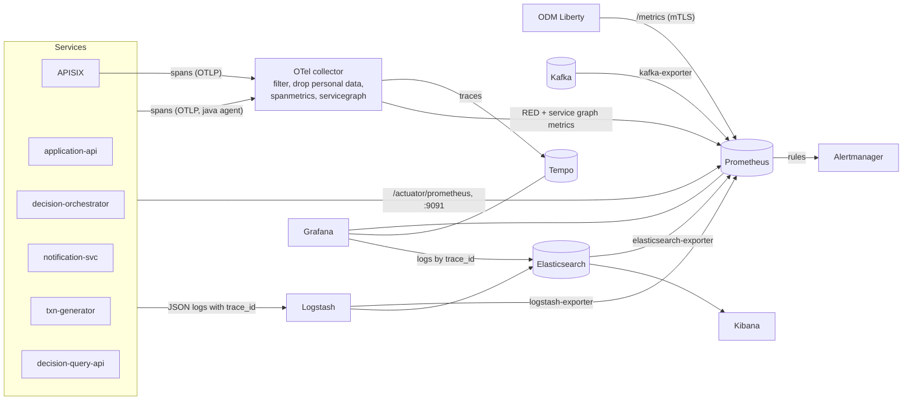
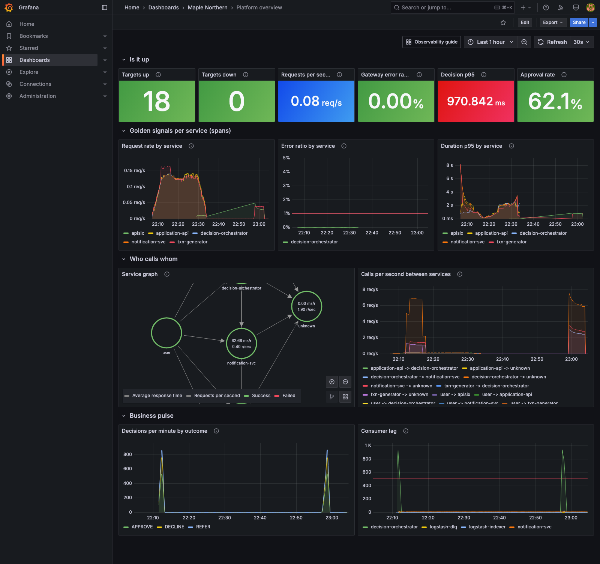
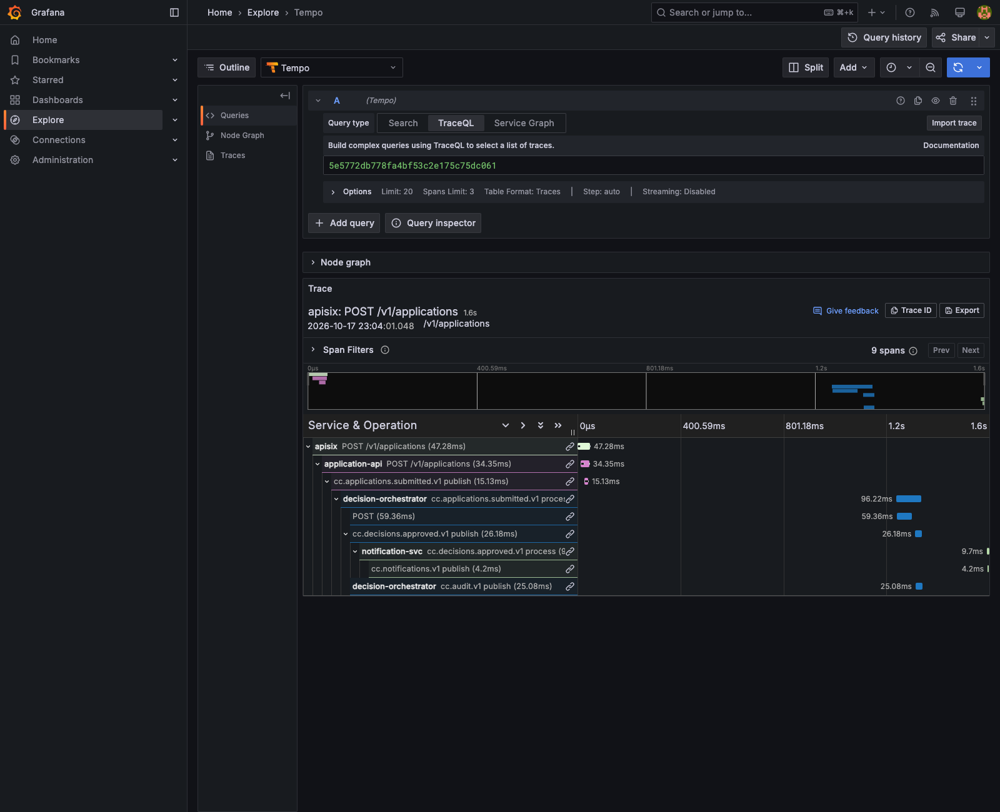
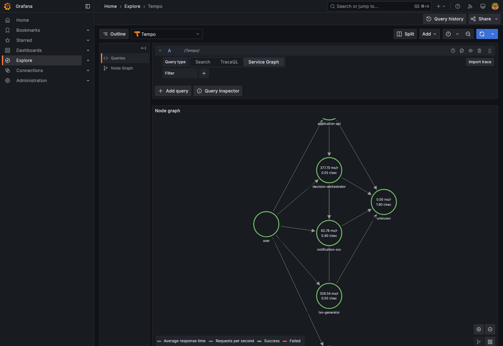

# Observability (P8): metrics, traces, alerts, dashboards

The Dynatrace substitute ([ADR-0005](adr/0005-lgtm-instead-of-dynatrace.md), updated by [ADR-0009](adr/0009-elk-ingestion.md)): OpenTelemetry for
traces, Prometheus for metrics, Tempo to store traces, Grafana to look at them, Alertmanager for infrastructure alerts. **Logs stay in ELK**
(Filebeat, Logstash, Elasticsearch, Kibana): Grafana reads `cc-logs` through a read-only user to jump from a trace to its log lines. No Loki, no
`otel-lgtm`: seven small pinned containers (about 1 GB), profile `obs`.

```bash
make up-obs          # = make up PROFILE=core,edge,obs  (no Kibana: fits a 7 GB Docker VM)
make demo            # traffic
make grafana-shots   # screenshots of every dashboard, the service graph and a trace waterfall
```

| Where | What | Login |
|---|---|---|
| <https://localhost:3000> | Grafana (our CA signed it) | `admin`, `GRAFANA_ADMIN_PASSWORD` of the root env file; anonymous access is off |
| <http://localhost:9090> | Prometheus (targets, rules, queries) | none, loopback only |
| <http://localhost:9097> | Alertmanager (9093 on the host is Kafka) | none, loopback only |

Grafana is reached directly over HTTPS on port 3000, not behind the API gateway: it has its own login, it is an operator tool, and behind APISIX it
would need a sub-path, WebSocket pass-through and a role for a UI that is not an API. The gateway stays the only door to the *APIs*.

## Signals



* **Traces.** The OpenTelemetry Java agent (2.26.1, checksum pinned in each Dockerfile) is in the five Java services; APISIX has its own plugin. One
  application is **one trace**: gateway, application-api, the Kafka publish, the orchestrator's consume (trace context travels in the Kafka record
  headers, the agent does it), the HTTP call to ODM, the Kafka publish of the decision, the notification service. ODM itself is not instrumented:
  its time is the orchestrator's client span. Sampling is `parentbased_always_on` locally (`always_on` at the gateway); in production use
  `parentbased_traceidratio` with `OTEL_TRACES_SAMPLER_ARG=0.1` (10%).
* **Logs carry the trace.** The JSON logs have `trace_id` and `span_id` (the agent puts them in the logging MDC; Logstash keeps them; `cc-logs`
  maps them as keywords). In Grafana a Tempo span links to its logs (`trace_id:"..."` in Elasticsearch), and a log line links back to the trace.
* **Collector.** Receives OTLP, drops scrape and probe spans, deletes personal-data attributes (`sin`, names, postal code, birth date, authorization
  and cookie headers), batches, sends to Tempo, and turns spans into metrics (spanmetrics: rate, errors, duration per service; servicegraph: calls
  between services). The traffic to the collector is plain OTLP inside the compose network; TLS to it is a Kubernetes item (P10: cert-manager
  certificate and NetworkPolicy).
* **Metrics.** Prometheus keeps 2 days and scrapes: the Spring services (Micrometer, `/actuator/prometheus`), the gateway, ODM Liberty
  (`/metrics`, MicroProfile Metrics, over mutual TLS with the admin certificate), kafka-exporter (TLS to the broker), elasticsearch-exporter (user
  `metrics_exporter`, monitor privileges only), logstash-exporter (`amd64` image, runs under Rosetta emulation on Apple Silicon), the collector,
  Tempo, Grafana, Alertmanager, and blackbox-exporter probes of the TLS endpoints (certificate expiry).
* **Business metrics.** The orchestrator counts `decisions_total{outcome,product,province}` (no identifier, nothing about a person), times the ODM
  call (`res_call_seconds`, with histogram buckets) and exposes the circuit breaker (`res_circuitbreaker_state`: 0 closed, 1 half open, 2 open).

## Dashboards (Grafana, folder Maple Northern, provisioned from `observability/grafana/dashboards`)

The JSON is generated by `observability/grafana/bootstrap/gen_dashboards.py` (`scripts/lint-observability.sh` fails if the committed JSON differs from
the generator, so edit the generator and rerun it). Provisioning is read-only (`allowUiUpdates: false`); to try a change, "Save as" a copy in the UI.

| Dashboard | Shows |
|---|---|
| Platform overview | targets up and down, gateway error ratio, decision p95, approval rate; rate, errors, duration (RED) per service from the spans; the service graph; calls between services |
| Kafka | consumer lag by group and topic, messages per second in and out, dead letters (rate and total) |
| JVM | heap used ratio, heap, GC pause time, threads, CPU, non-heap, classes per service |
| API SLO | availability against 99.5%, error budget burn, latency p95/p99 at the gateway, requests by status and route |
| APISIX gateway | requests by status, 429 and 403, latency percentiles, upstream latency per route, connections, bandwidth |
| Elasticsearch and Logstash | cluster status, heap, documents, indexing and search rate, GC; Logstash events in/out/filtered per pipeline, queues, heap, dead letter queue |
| ODM decision latency | p50/p95/p99 of the RES call, the same call from the spans, circuit breaker, ODM heap, CPU, requests by route, the slowest traces (TraceQL) |
| Business metrics (mini) | approval, referral and decline rate and decisions per minute from the counters (the full business analytics are in Kibana, [docs/kibana.md](kibana.md)) |

`make check-dashboards` runs every query of the dashboards against the live Prometheus and lists those that return no data; `make grafana-shots` takes
the screenshots below (and reports panels that show "No data" or an error).







More: [Kafka](images/grafana-kafka.png), [JVM](images/grafana-jvm.png), [API SLO](images/grafana-api-slo.png), [APISIX](images/grafana-apisix.png),
[Elasticsearch and Logstash](images/grafana-elasticsearch-logstash.png), [ODM](images/grafana-odm-latency.png), [Business](images/grafana-business.png).

## Alerts: two systems with a clear split

| | Kibana alert rules ([docs/kibana.md](kibana.md#alert-rules)) | Prometheus rules (this page) |
|---|---|---|
| About | **business**: what the data says | **infrastructure and SLO**: whether the platform works |
| Examples | dead letters in the data in 5 min, error log lines, p95 latency from the decision documents, approval rate drop vs the last hour | consumer lag, dead letter rate on the topics, ODM p95, gateway 5xx, target down, JVM and Elasticsearch heap, certificate expiry |
| Notifies | server log and the `cc-alerts` index (shown on the Kibana operations dashboard) | Alertmanager (UI at :9097; the receiver is empty on purpose: add a webhook, chat or e-mail receiver for a real deployment) |

The two overlap on purpose in two places (dead letters, latency): one sees the cause (Kafka offsets, Micrometer), the other the effect (documents).

| Prometheus alert | Fires when | Runbook |
|---|---|---|
| KafkaConsumerLagHigh | a group is more than 500 messages behind for 5 min | [runbook](runbooks/alerts/KafkaConsumerLagHigh.md) |
| DeadLetterRate | anything was written to a `*.dlq` topic in 5 min | [runbook](runbooks/alerts/DeadLetterRate.md) |
| DecisionLatencyP95High | p95 of `res_call_seconds` above 300 ms for 5 min | [runbook](runbooks/alerts/DecisionLatencyP95High.md) |
| ApiErrorRateHigh | more than 1% of gateway requests are 5xx for 5 min | [runbook](runbooks/alerts/ApiErrorRateHigh.md) |
| TargetDown | a scrape target is down 2 min, or a TLS probe fails 3 min | [runbook](runbooks/alerts/TargetDown.md) |
| JvmHeapHigh | a service (or ODM) above 85% of its heap for 5 min | [runbook](runbooks/alerts/JvmHeapHigh.md) |
| ElasticsearchHeapHigh | Elasticsearch heap above 85% for 5 min | [runbook](runbooks/alerts/ElasticsearchHeapHigh.md) |
| CertificateExpiringSoon | a probed certificate expires in under 14 days (blackbox-exporter; `make cert-expiry` lists all certificates) | [runbook](runbooks/alerts/CertificateExpiringSoon.md) |

The SLO recording rules (`observability/prometheus/rules/slo.yml`) are the building blocks: gateway error ratio (5 min and 1 h), error budget burn against
the 0.5% budget, latency p95 and p99, decision latency p95 and p99, JVM heap ratio.

## Follow one application

1. Submit through the gateway (`make api-call CLIENT=demo-partner ...` or `docs/api/README.md`); the response has the `correlationId` (and every
   service log line carries it).
2. **Trace:** Grafana > Explore > Tempo > TraceQL `{ resource.service.name = "apisix" && name = "POST /v1/applications" }`, open a trace: the waterfall
   shows apisix, application-api, the Kafka publish, the orchestrator's process span, its `POST` to ODM, the decision publish, and the notification
   service. Click a span, **Logs for this span**: the log lines of the trace from `cc-logs`.
3. **Logs and business view:** the trace id is in every log line (`trace_id`). In Kibana, dashboard "Trace an application" takes the correlation id and shows
   the decision, the audit trail, the notices, dead letters and logs in order.
4. **From a log line to the trace:** Grafana > Explore > Elasticsearch (logs); the `trace_id` field links to Tempo.

## Memory (7 GB Docker VM, 8 CPUs)

| Group | Containers | Measured (docker stats) |
|---|---|---|
| core + edge | kafka, elasticsearch (1.25 GB limit, heap 640 MB), odm, logstash (896 MB), filebeat, the five Java services (64 MB more each for the agent), apisix | about 4.6 GB |
| obs | otel-collector 128 MB, tempo 320 MB, prometheus 256 MB, grafana 192 MB, alertmanager 64 MB, kafka-, elasticsearch- and logstash-exporter 64 MB each, blackbox-exporter 32 MB (limits) | about 0.7 GB |
| analytics | kibana, kafka-ui, decision-query-api | about 1.1 GB |

`make up-obs` (core, edge, obs) uses about 5.2 GB and is the way to run it. **All four profiles together** (`make up PROFILE=core,analytics,edge,obs`) total
5.4 GB, which is below the 7.26 GB of the Docker VM, but starting that many JVMs at once saturates the CPUs: health checks time out (Kafka, Logstash and
Kibana went unhealthy for minutes in the test run). So: run observability without analytics (`make up-obs`), or start the analytics profile after the
rest has settled; on a larger Docker VM all four are fine.

## Dynatrace compared

| | Dynatrace | This stack |
|---|---|---|
| Distributed traces across services and Kafka | OneAgent, automatic | OpenTelemetry agent per service, Kafka headers automatic; one trace gateway to notification **(match)** |
| Service map | Smartscape / Davis topology, automatic | service graph from spanmetrics **(match for the instrumented services; ODM and Kafka show as "unknown" peers)** |
| Metrics, JVM, infrastructure | automatic | Micrometer, Prometheus, exporters, dashboards written by us **(match, hand built)** |
| Log to trace link | automatic | `trace_id` in the JSON logs, links both ways in Grafana **(match)** |
| Alerting and SLOs | Davis problems, SLOs | Prometheus rules, recording rules, error budget burn, runbooks **(match, thresholds are ours)** |
| Auto-discovery and zero-config instrumentation | yes, hosts, processes, databases, new services | no: each service gets the agent and a scrape target by hand **(gap)** |
| Root-cause analysis with AI (Davis) | yes, correlates events and topology into one problem | none: dashboards, traces and runbooks; a person correlates **(gap)** |
| Code-level profiling, memory dumps, real user monitoring, synthetic browser tests | yes | none (only blackbox probes) **(gap)** |
| Anomaly detection and baselining | automatic baselines | fixed thresholds and one 1-hour baseline rule in Kibana **(gap)** |
| Cost and effort | licence per host/GiB | free software; we run, size and upgrade it |
