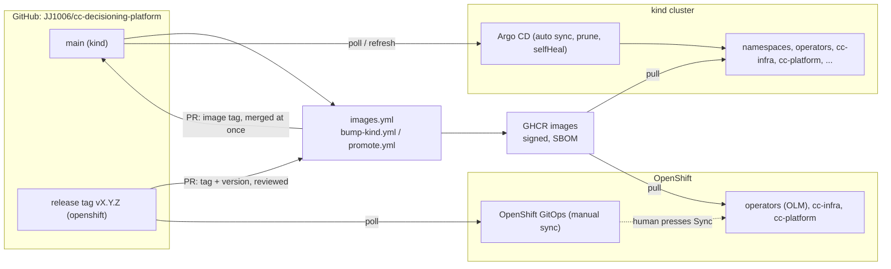

# GitOps with Argo CD (P11)

Git is the only way anything reaches a cluster: the charts of [deploy-kubernetes](../deploy-kubernetes.md) are installed and kept in shape by Argo CD,
from this repository. Decision: [ADR-0014](../adr/0014-gitops-argocd.md). Files: `deploy/argocd/`.



## Layout

| Path | What |
|---|---|
| `deploy/argocd/bootstrap/argocd/` | Argo CD v3.5.5 as a kustomization: no Dex, no notifications, no ApplicationSet controller, small requests/limits (about 0.7 GB in all) |
| `deploy/argocd/bootstrap/root/<env>.yaml` | the one Application applied by hand: renders `apps/<env>` and `projects/` |
| `deploy/argocd/bootstrap/openshift/` | the OpenShift GitOps operator Subscription |
| `deploy/argocd/projects/` | AppProjects `root`, `platform`, `apps` (+ the OpenShift overlay) |
| `deploy/argocd/apps/<env>/` | one Application per piece, numbered by order; `values/` holds the files that CI and humans change (image tag, per-environment overrides) |
| `deploy/argocd/namespaces/`, `operators/openshift/` | the Namespace (Pod Security level) and the OLM Subscriptions |

### Projects

| Project | May deploy | Cluster-scoped kinds | Sources |
|---|---|---|---|
| `root` | Applications and AppProjects in the Argo CD namespace | none | this repository |
| `platform` | operators, `cc-infra`, Filebeat, observability: namespaces `cc`, `cert-manager`, `strimzi-system`, `elastic-system`, `ingress-nginx` | Namespace, CRD, ClusterRole(Binding), Validating/MutatingWebhookConfiguration, IngressClass, ClusterIssuer | this repository + the pinned chart repositories (jetstack, strimzi, elastic, ingress-nginx) |
| `apps` | `cc-platform`: namespace `cc` only | **none** | this repository only |

### Sync waves

| Wave | Application | Project |
|---|---|---|
| -4 | `namespaces` (Namespace `cc` with its Pod Security level; never pruned) | platform |
| -3 | `cert-manager`, `strimzi`, `eck` and `ingress-nginx` (kind-full), pinned charts; on OpenShift `operators` (OLM) | platform |
| -1 | `cc-infra`: Kafka, topics, users and ACLs, ECK, the issuer, default-deny policies (the `es-setup` Job is a PostSync hook) | platform |
| 0 | `cc-platform`: services, gateway, ODM (dev), Logstash; `filebeat` (kind-full) | apps / platform |
| 1 | `cc-observability` (kind-full): Prometheus stack, Tempo, collector | platform |

The plan had namespaces and policies at -2; the namespace is at **-4** because the operators create Roles in `cc` and must find it. The policies are part of
`cc-infra` (-1).

## Environments

| | kind-lite | kind-full | openshift |
|---|---|---|---|
| Argo CD | installed by `make argocd-up` | same | OpenShift GitOps operator (`openshift-gitops`) |
| Revision | `main` | `main` | **release tag** (`v0.1.2`), chart and values |
| Image tag | commit SHA of main, bumped by `bump-kind.yml` | same | release version, bumped by `promote.yml` |
| Sync | **automated**, prune, selfHeal, retry with backoff | same | **manual**: a human presses Sync |
| Operators | Helm charts, pinned | + ECK, ingress-nginx | OLM Subscriptions, install plans approved by hand |
| Gates | none (CI on the pull request) | none | review (CODEOWNERS) **and** manual sync |

## Run it on kind

```bash
make down V=1                       # compose stops: the RAM is shared (7 GB Docker VM)
make argocd-up ENV=kind-lite        # cluster, secrets, Argo CD, projects, root; waits until every Application is Synced and Healthy
make argocd-status                  # applications, waves, sync, health
make kind-deploy-rules && make kind-demo
make argocd-ui                      # https://localhost:8080, user admin, the password from the cluster secret (printed to the terminal only)
make argocd-down                    # deletes the cluster
```

* `REVISION=<branch>` points every Application at a branch (test a change before it is in `main`): `REVISION=feat/x make argocd-up`.
* `IMAGES=local` uses images built here and loaded into kind (tag `dev`) instead of the GHCR tag: `IMAGES=local make argocd-up`.
* Secrets stay **outside** Argo CD: `scripts/k8s-secrets.sh` creates them (the platform CA keypair, store passwords, ODM and Elasticsearch users). They are not in git and
  not tracked by any Application, so Argo never prunes them; the Namespace carries `Prune=false,Delete=false` so deleting it from Git cannot take them away either.
  For OpenShift or production use Sealed Secrets (the sealed file is in git, the controller decrypts it in the cluster) or External Secrets (an `ExternalSecret`
  per secret of [deploy-kubernetes](../deploy-kubernetes.md#secrets)); both fit as one more Application at wave -2.
* **Repository access.** The repository is public: Argo CD reads it anonymously and the GHCR packages are public (anonymous pulls work). If the repository
  becomes private: `scripts/argocd-repo-secret.sh` adds a read-only deploy key and the Argo CD repository secret (nothing committed), and the `repoURL`s change to
  the ssh form. If the packages become private: `gh auth refresh -s read:packages && scripts/argocd-pull-secret.sh`, then
  `global.imagePullSecrets: [{name: ghcr-pull}]` in `values/cc-platform.yaml`.

### Ignored differences (what Argo must not fight)

| Application | Resource and field | Why |
|---|---|---|
| cert-manager | `*WebhookConfiguration cert-manager-webhook`: `clientConfig.caBundle` | injected by cert-manager's cainjector |
| eck | `ValidatingWebhookConfiguration elastic-webhook.k8s.elastic.co`: `caBundle`; Secret `elastic-webhook-server-cert`: `data` | written and rotated by the operator |
| cc-infra | Kafka `spec.kafka.metadataVersion` | the operator moves it after a Kafka upgrade |
| cc-infra | KafkaTopic `spec.config`, `spec.replicas` | the topic operator may normalise them |
| cc-observability | `*WebhookConfiguration`: `caBundle` | patched by the Prometheus operator admission job |

Everything else must match Git: an unexpected `OutOfSync` is a finding, not something to ignore. These entries come from how the operators behave; the kind run needed none of the
CRD ones to be Synced, and `ServerSideApply=true` keeps defaulting by the API server out of the diff.

## Promotion

1. A pull request merges to `main`. `images.yml` builds, signs and pushes `ghcr.io/jj1006/cc-*:<sha>` (amd64 + arm64).
2. `bump-kind.yml` (after a successful images run) opens a pull request that changes **only** `global.image.tag` in `deploy/argocd/apps/kind-*/values/cc-platform.yaml`
   (it fails if anything else changed) and merges it at once. Argo CD on kind syncs the new tag by itself.
3. A release (release-please) creates the tag `vX.Y.Z`. Tags created with the default token start no workflows, so `release.yml` starts `images.yml` for the tag and
   `promote.yml`. `promote.yml` opens a pull request that pins `deploy/argocd/apps/openshift` (chart and values revision) to the tag and the image tag to `X.Y.Z`.
4. **Gate 1**: the pull request is reviewed (`CODEOWNERS` covers `deploy/argocd/apps/openshift/`); check that the images run for the tag is green.
5. **Gate 2**: in OpenShift GitOps open each Application (operators, `cc-infra`, `cc-platform`), read the diff and press **Sync** (or `argocd app sync`), in wave order.

## Drift and self-heal (kind)

Change anything by hand and Argo reverts it: `kubectl -n cc scale deploy/notification-svc --replicas=0` is back to 1 within about half a minute (the
Application goes OutOfSync, a partial sync runs, Synced again). A Git change reaches the cluster without anyone touching it (default poll: 3 minutes;
`argocd.argoproj.io/refresh=hard` forces it). To change something deliberately, change Git.

## Rollback

* **Git first**: `git revert <commit>` and merge; kind syncs it by itself, on OpenShift press Sync. This keeps Git and the cluster identical.
* **Fast**: in the Argo CD UI or `argocd app rollback <app> <id>` returns to a previous synced revision. With automated sync the Application re-syncs to Git at once,
  so on kind this only holds if you first disable auto-sync (`argocd app set <app> --sync-policy none`); on OpenShift (manual) it holds until the next Sync. Then revert in Git.
* The image tag is the usual thing to roll back: revert the bump commit (kind) or the promotion commit (OpenShift).

## Break-glass

1. Stop Argo from undoing you: `argocd app set <app> --sync-policy none` (or `kubectl -n argocd patch application <app> --type merge -p '{"spec":{"syncPolicy":null}}'`).
2. Fix the cluster by hand.
3. Put the same change in Git, merge, then re-enable (`argocd app set <app> --sync-policy automated --auto-prune --self-heal`, or `git revert` of nothing: the root application
   restores the policy from Git at its next sync).
4. Anything done by hand and not in Git is lost at the next sync on kind, and shows as a diff on OpenShift.

## OpenShift GitOps

```bash
oc apply -f deploy/argocd/bootstrap/openshift/subscription.yaml                # OpenShift GitOps operator; approve its install plan
oc -n openshift-operators get installplan                                       # oc patch installplan <name> --type merge -p '{"spec":{"approved":true}}'
oc new-project cc
oc label namespace cc argocd.argoproj.io/managed-by=openshift-gitops          # lets the default Argo CD instance manage cc
# secrets of docs/deploy-kubernetes.md (Sealed Secrets / External Secrets), and the CA of the issuer
oc apply -k deploy/argocd/projects/openshift
oc apply -f deploy/argocd/bootstrap/root/openshift.yaml                        # root: manual sync - open it in the console and press Sync
```

* The default instance runs as cluster admin, which `platform` needs for CRDs and ClusterRoles; the `apps` project still cannot create cluster-scoped objects.
* Operators come from OperatorHub (`deploy/argocd/operators/openshift`): install plans are **Manual**. Pin `startingCSV` after choosing versions with
  `oc get packagemanifest <name> -o jsonpath='{.status.channels[*].currentCSV}'` (not guessed in the repository).
* `deploy/argocd/apps/openshift/values/cc-infra.yaml` needs the platform CA certificate (public) as `pki.caPem` for the Kibana Route; paste it in the pull request that sets up the cluster.
* There is no Argo CD without its own cluster: the first sync of the root is the human act that starts everything; after that each Application is a manual sync.
