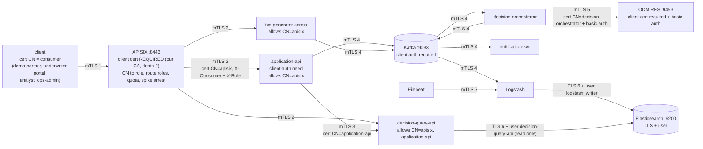

# Mutual TLS on every hop (P6)

One private CA (`scripts/pki.sh`, `make pki`; cert-manager replaces it on Kubernetes in P10) signs every certificate. Every connection on the
request and event paths presents a certificate and verifies the other side against that CA. Decisions: [ADR-0008](adr/0008-mtls-everywhere.md),
[ADR-0011](adr/0011-gateway-identity.md). Checked from the outside by `make verify-mtls`.



## Every hop

| # | From | To | Client presents | Server checks | Who the caller is (authentication, authorization) |
|---|---|---|---|---|---|
| 1 | API client | APISIX `:8443` (the only published API port) | its certificate (`security/pki/out/<name>/`) | our CA, depth 2; no certificate or another CA: handshake refused | CN becomes the consumer; the global rule maps it to a role and the route's `labels.roles` must contain it, else 403; quota 100 per minute per consumer (429); spike arrest on `POST /v1/applications` (429) |
| 2 | APISIX | application-api, decision-query-api, txn-generator (`:8080`) | `apisix` certificate (client cert of the upstream) | Tomcat `client-auth=need` against our CA, then the filter: CN must be in `platform.security.allowed-client-cns` (`apisix`; decision-query-api also `application-api`) | only CN=apisix may assert `X-Consumer` and `X-Role`; the gateway deletes whatever the client sent and sets them from the certificate; APISIX verifies the service certificate (SAN = service name) against our CA |
| 3 | application-api | decision-query-api | `application-api` certificate | same filter; CN=application-api is a SERVICE caller (headers ignored) | role SERVICE |
| 4 | every service, Logstash, kafka-ui, topic-init | Kafka `:9093` | its own certificate (`<service>.p12`, `logstash.p12`, `kafka-ui.p12`, `admin` for topic-init and the CLI) | `ssl.client.auth=required`, our CA | principal = certificate subject; ACLs are not enabled locally (see below) |
| 5 | decision-orchestrator | ODM RES `:9453` | `decision-orchestrator` certificate **and** HTTP basic auth (`resAdmin`) | Liberty `clientAuthentication=true` against our CA | ODM user (basic auth) |
| 6 | Logstash, decision-query-api | Elasticsearch `:9200` | password of a least-privilege user over TLS that verifies our CA | HTTPS, user and role (`logstash_writer`: create documents on the write aliases; `decision-query-api`: read on the read aliases) | ES role. The PKI realm (login by certificate) needs a paid licence: `security.realms.pki.available` is `false` on the basic licence, so no certificate login |
| 7 | Filebeat | Logstash beats input `:5044` | `filebeat` certificate | TLS, client certificate required, our CA | n/a |

Not on the API path and not mutual TLS: Kibana (HTTPS, login), kafka-ui (plain http on `127.0.0.1:8080`, no login, dev tool; it connects to Kafka with
its own certificate), the Spring management port `9090` of the three API services (plain http inside the Docker network, not published: probes
and metrics), the KRaft controller listener (plaintext, not published; `make verify-mtls` checks it).

## Identity: why the headers can be trusted

`X-Consumer` and `X-Role` are ordinary headers, so any client could write them. Two things make them safe:

1. The gateway removes both headers from the incoming request and sets them from the verified certificate's CN
   (`gateway/apisix/apisix.yaml.tmpl`, global rule). `make verify-mtls` sends a partner certificate with `X-Role: UNDERWRITER`: still 403.
2. A service believes the headers only on a connection whose certificate has CN=apisix (`ClientCertFilter` in `common-lib`). Nobody else holds that
   private key, so nobody else can reach a service with headers it will believe. A service reached with any other certificate from our CA is refused
   by CN (403), and with no certificate or another CA the handshake fails. `make verify-mtls` tries each of these from inside the Docker network.

So the gateway key (`security/pki/out/apisix/`) is the crown jewel: whoever has it can claim any role. Locally it is a world-readable file in a
gitignored folder; on Kubernetes it is a cert-manager secret of the gateway namespace, and NetworkPolicies allow only the gateway to reach the services.

## Rotation

```bash
scripts/cert-expiry.sh            # make cert-expiry: days left on every certificate, warns below 14, exits non-zero when expired
make pki FORCE=1                  # wipe and reissue the CA and every certificate (new CA: every hop changes at once)
make down && make up PROFILE=core,analytics,edge     # containers read keystores at start
make verify-mtls
```

* **One leaf certificate** (CA unchanged): delete that folder under `security/pki/out/` (for example `security/pki/out/analyst`), run `make pki`
  (it creates what is missing), then restart the container that mounts it. The client certificates of consumers are handed out outside the stack.
* **CA rotation without downtime** (production practice, not automated here): issue the new CA, put old and new in every truststore, reissue
  leaf certificates, restart, then remove the old CA. Locally `FORCE=1` is a hard cut.
* **APISIX** renders its configuration from the template at start, so a new gateway certificate needs `docker compose restart apisix`.
  **ODM** reads its keystore and truststore at start.
* Leaf certificates last 825 days, the CA 3650 (`DAYS_LEAF`, `DAYS_CA` in `scripts/pki.sh`).

## Browser and tools

* **Decision Center and RES console** need a client certificate in the browser: import `security/pki/out/admin/admin.p12` (password: `PKI_PASSWORD`
  of the root env file) and trust `security/pki/out/ca/ca.crt`. Command line: `scripts/dc.sh`, `scripts/es-curl.sh`, `scripts/api-call.sh`.
* **Debugging a service directly**: `COMPOSE_DEBUG=1 make up PROFILE=core,analytics,edge` publishes the service ports (still mutual TLS) and ODM's
  plain port 9060; see the comments in `deploy/compose/compose.debug.yml` for presenting the gateway certificate.

## Kafka clients and ACLs (ready for Strimzi in P10)

Locally the broker authenticates by certificate but authorizes everything (no `authorizer.class.name`). Under Strimzi each row becomes a
`KafkaUser` of type `tls` (principal `CN=<name>,O=Maple Northern Bank (demo)` with `authentication: tls`, or a cert-manager issued
certificate) with `authorization: simple` ACLs. The retry and dead-letter topics follow `<topic>.retry` / `<topic>.dlq`.

| Client (certificate CN) | Reads (consumer group) | Writes | Other |
|---|---|---|---|
| `txn-generator` | | `cc.applications.submitted.v1` | |
| `application-api` | | `cc.applications.submitted.v1`, `cc.decisions.manual.v1`, `cc.audit.v1` | transactional id prefix `application-api-tx-` |
| `decision-orchestrator` | `cc.applications.submitted.v1` (`decision-orchestrator`) | `cc.decisions.{approved,declined,referred}.v1`, `cc.audit.v1`, `cc.applications.submitted.v1.dlq` | transactional id prefix `orchestrator-tx-` (consume-transform-produce) |
| `notification-svc` | `cc.decisions.{approved,declined,referred,manual}.v1` (`notification-svc`) | `cc.notifications.v1`, the `.dlq` topics it consumes | |
| `logstash` | `cc.decisions.*.v1`, `cc.audit.v1`, `cc.notifications.v1` (`logstash-indexer`); every `*.dlq` (`logstash-dlq`) | | |
| `kafka-ui` | all topics, describe | | operator tool; read-only in production |
| `admin` (topic-init, CLI) | | | create, alter, describe topics and groups |

## Limits of the demo

* One CA, one host: certificate revocation is not implemented (rotate instead).
* The consumer table is in the gateway file; production would load consumers from a registry and use short-lived certificates.
* The Elasticsearch passwords (`LOGSTASH_WRITER_PASSWORD`, `QUERY_API_PASSWORD`) are generated into the gitignored root env file.
