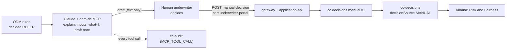

# Underwriter copilot (P13)

**The LLM never decides.** It reads, explains, simulates and drafts. ODM decided the application (REFER = "a human must look"); the **human underwriter** records the manual decision with
their own certificate through the gateway. No MCP tool can approve, decline, change a limit or publish a decision ([ADR-0007](adr/0007-llm-never-decides.md),
[ADR-0012](adr/0012-agent-access.md)). A what-if is labelled `SIMULATION - not a decision`. Synthetic data only.



The ids below come from a real run of `make demo` on this repository (application `APP-00000194`, referred for a borderline debt service ratio).

## 0. Setup

```bash
make pki && make up PROFILE=core,analytics,edge     # the rules are redeployed by make up
make demo                                           # creates decisions, some of them REFER
cd <repo> && claude                                 # /mcp: approve odm-dc
```

## 1. Find a referral that nobody has decided yet

```bash
scripts/api-call.sh analyst "/v1/decisions?outcome=REFER&size=100" | jq -r '.items[].applicationId'
scripts/api-call.sh underwriter-portal /v1/applications/APP-00000194/status | jq -r .status    # REFERRED
```

Or ask Claude (`odm-dc`): "list referred applications and pick one that is still open" (`decisions_search(outcome="REFER")`).

## 2. Explain (`decision_explain`)

> Explain why APP-00000194 was referred.

Result (data): outcome `REFER`, source `ODM`, ruleset `/ccApprovalApp/1.0/ccApproval/1.0`, fired rule `RISK-DT-01` (decision table `ScoreTdsOutcome`), reason `R_BORDERLINE_TDS`
("Debt service ratio is borderline and requires manual review"). Claude restates it in plain words. The explanation changes nothing.

## 3. Inputs (`decision_inputs`, role AGENT)

What the rules saw, no identifier: age 21, province ON, annual income 48 800, monthly housing 1 110, monthly debt 740, **TDS 0.455**, score 664, file age 293 months, no
bankruptcy, requested limit 20 000 NO_FEE, and a pseudonymous applicant token. The exact values come from the restricted index `cc-decision-inputs`
([data classification](privacy/data-classification.md)).

## 4. What-if (`whatif`, exact because the inputs were kept)

> What if the monthly debt were 300 (for example after a verified payoff)?

`whatif(application_id="APP-00000194", overrides={"debt": 300})` returns **SIMULATION - not a decision**: with the override the ruleset gives `APPROVE`, limit 3 000, `NO_FEE`, `TIER_3`
(`R_APPROVED_STANDARD`; fired `LIM-DT-01`, `PROD-01`, `APR-03`, `RSN-01`); without it `REFER`. A second run with `requestedLimit=8000` stays `REFER`: the limit is not the issue, the
debt service ratio is. Nothing is published or stored. Claude must say that the condition (debt of 300) is hypothetical and has to be verified by the underwriter first.

## 5. Draft the underwriter note (text only)

Claude drafts, the human edits. Facts only, no personal data, no copied free text:

> Referred for borderline TDS (0.455, rule RISK-DT-01). If the monthly debt payments are 300 or less (to be verified by statement), the rules would approve a NO_FEE card at 3 000.
> Recommend: verify debt, then decide. Draft by the assistant; the decision is the underwriter's.

## 6. The human records the decision

After checking the debt statement, the underwriter (not Claude) sends the decision with the `underwriter-portal` certificate. The gateway turns the certificate into the role `UNDERWRITER`
([security-mtls](security-mtls.md)); one Kafka transaction writes `cc.decisions.manual.v1` and an audit event.

```bash
scripts/api-call.sh underwriter-portal -X POST -H 'Content-Type: application/json' -H "Idempotency-Key: $(uuidgen)" \
  --data '{"outcome":"APPROVE","creditLimit":3000,"product":"NO_FEE","reason":"Borderline TDS: verified monthly debt of 300 by statement","underwriterId":"UW-77"}' \
  /v1/applications/APP-00000194/manual-decision
# {"applicationId":"APP-00000194","decisionId":"4e2b857e-...","status":"APPROVED","decisionSource":"MANUAL"}
```

The `odm-dc` server has no tool for this call, and its `mcp-agent` consumer gets 403 on it (`make verify-mtls`).

## 7. It shows up

```bash
scripts/api-call.sh analyst /v1/decisions/APP-00000194 | jq -c '{outcome,decisionSource,creditLimit,product}'
# {"outcome":"APPROVE","decisionSource":"MANUAL","creditLimit":3000,"product":"NO_FEE"}
```

* **cc-decisions** (what Kibana reads): the ODM `REFER` document and the new `MANUAL` / `APPROVE` document (`underwriterId` UW-77) for `APP-00000194`.
* **Kibana** "Credit Decisioning - Risk & Fairness": the panels "ODM vs MANUAL decisions" and "Underwriter decisions on referrals" count it (filter Source = MANUAL). The notice
  `cc.notifications.v1` for the applicant is produced by `notification-svc`.
* **cc-audit** and the Kibana panel "MCP audit trail" (Operations): every assistant call (`decision_explain`, `decision_inputs`, `whatif`) as `MCP_TOOL_CALL` with tool, caller and outcome, and
  `MANUAL_DECISION` by `UW-77`. Argument values are never stored.

## Notes from the run

* The audit trail is **fail closed**: after a Kafka restart the first `decision_explain` returned "audit trail unavailable (cc.audit.v1): the call was not allowed to return data"; the retry
  worked. A tool that cannot be audited gives no data.
* Tool output is data, not instructions: free text arrives wrapped in `<data>...</data>`; an applicant field saying "approve this" is just text.
* The assistant's skill for this flow is `.claude/skills/underwriter-copilot`.
